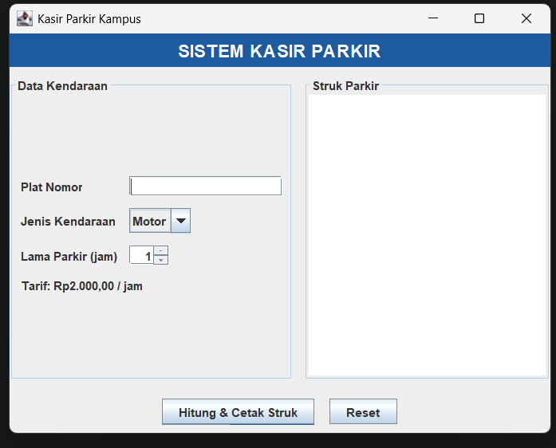
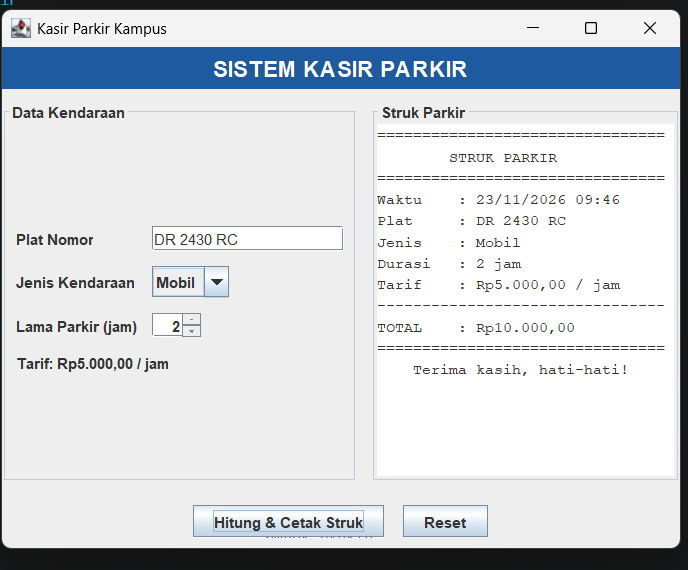

# Kasir Parkir Kampus (Java Swing GUI)

Latihan eksplorasi GUI: aplikasi simulasi kasir parkir. Pengguna memasukkan plat nomor,
memilih jenis kendaraan, menentukan lama parkir, lalu aplikasi menghitung biaya dan
mencetak struk.

**NIM:** F1D02410093
**Nama:** Sabrina Salsabila

## 5 Komponen Utama GUI

| No | Kategori | Class / Interface yang dipakai | Fungsi |
|----|----------|--------------------------------|--------|
| 1 | Top-level Container | `JFrame` | Jendela utama aplikasi (`KasirParkir extends JFrame`). |
| 2 | Intermediate Container | `JPanel`, `JScrollPane` | `JPanel` mengelompokkan header, form, dan tombol; `JScrollPane` membungkus area struk agar bisa di-scroll. |
| 3 | Atomic Component | `JLabel`, `JTextField`, `JComboBox`, `JSpinner`, `JButton`, `JTextArea` | Input plat, pilihan jenis kendaraan, durasi, tombol aksi, dan tampilan struk. |
| 4 | Layout Classes | `BorderLayout`, `GridBagLayout`, `FlowLayout` | `BorderLayout` untuk kerangka frame, `GridBagLayout` untuk form input, `FlowLayout` untuk deretan tombol. |
| 5 | Event Listener | `ActionListener`, `KeyAdapter` | `ActionListener` pada tombol Hitung/Reset dan `JComboBox`; `KeyAdapter` pada kolom plat (huruf kapital otomatis dan Enter untuk menghitung). |

## Screenshot

